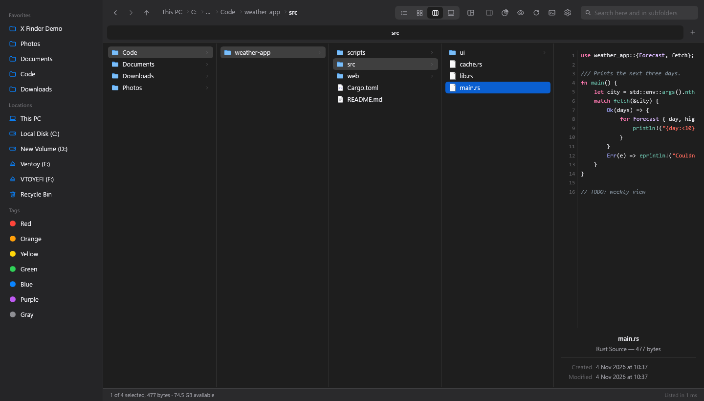
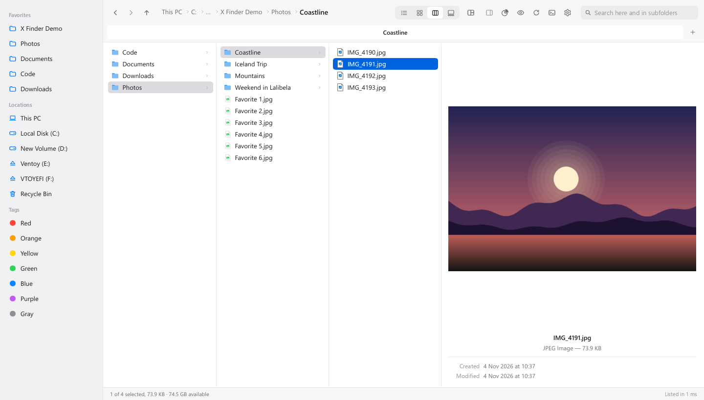
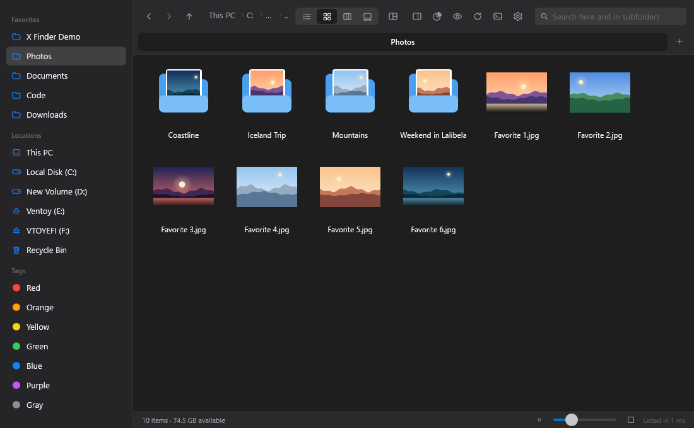
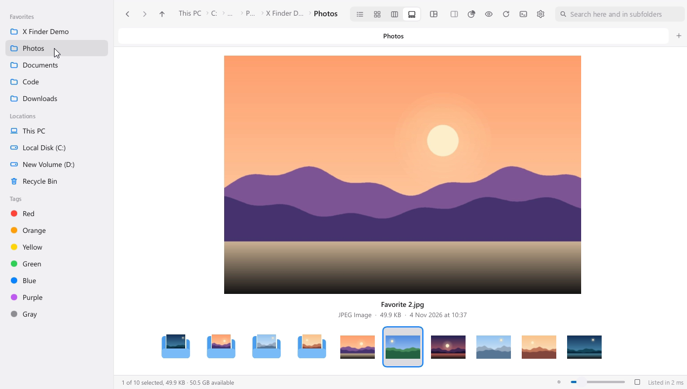
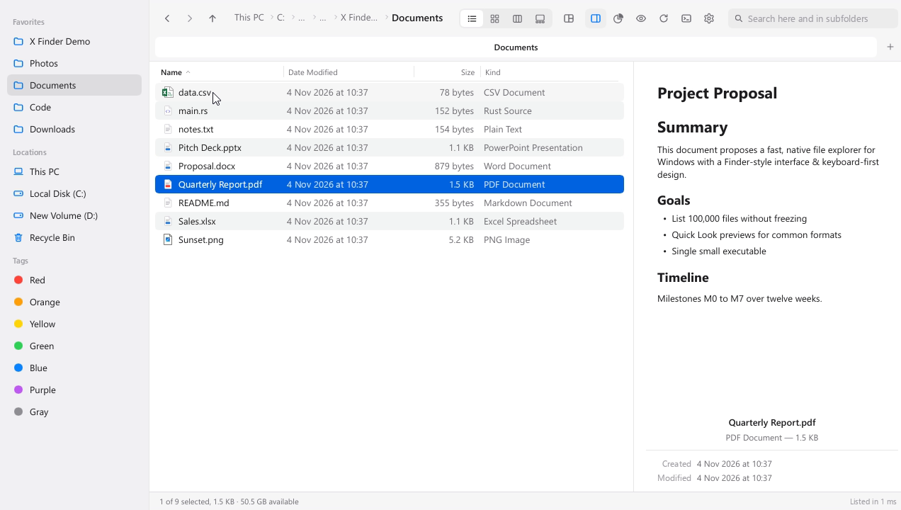
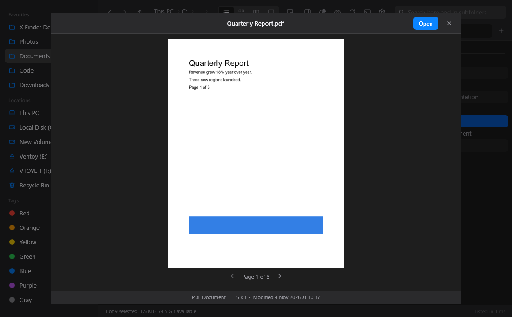
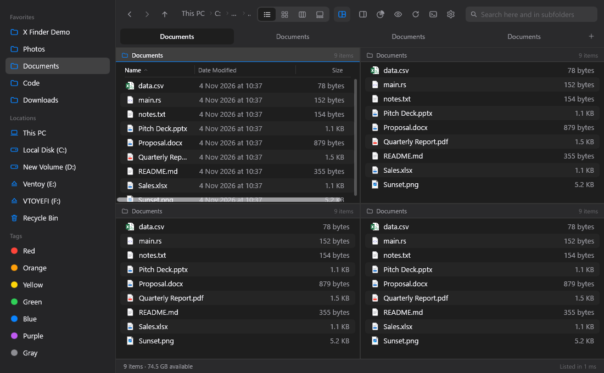
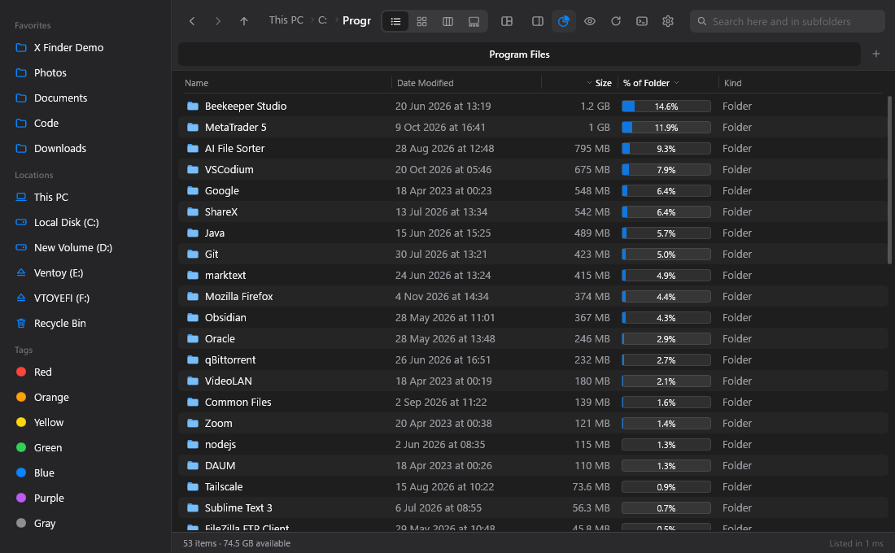
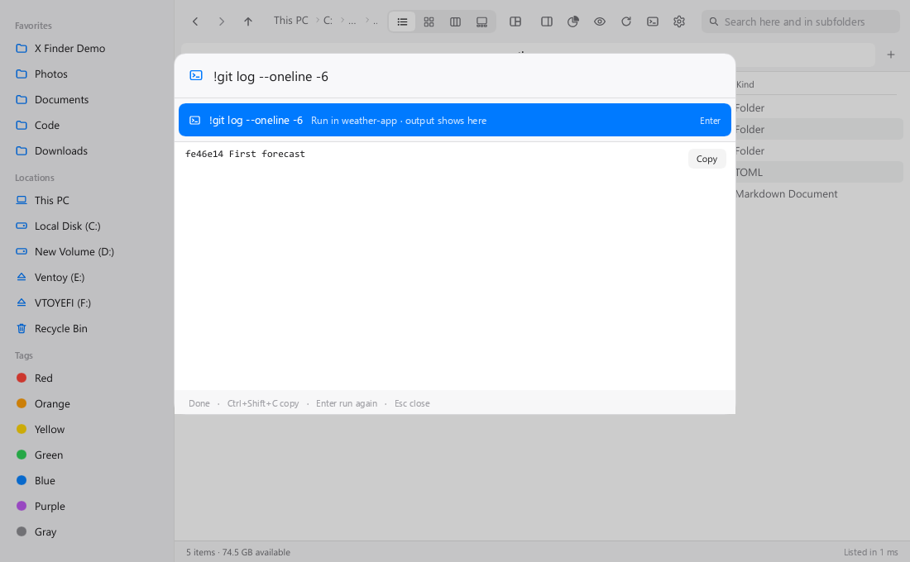
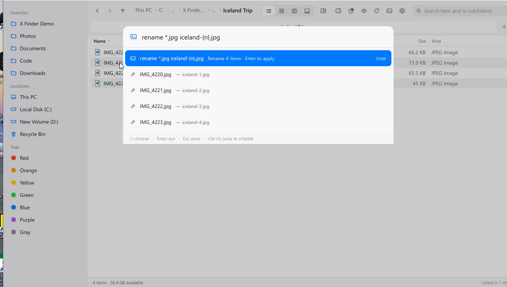

<div align="center">


# X Finder

**A fast, light, keyboard-first file explorer for Windows 10 and 11, inspired by the macOS Finder.**

Column view · Quick Look · search inside files · command palette · split panes · folder sizes · colour tags

[**Download for Windows**](../../releases/latest) · [Features](#features) · [Keyboard](#keyboard) · [Build from source](#build-from-source)



</div>

---

## Why X Finder?

Windows File Explorer shows one folder at a time, has no real preview and makes you reach for the mouse.
X Finder brings the Finder way of browsing to Windows and adds tools that power users, developers and
anyone who works with lots of files will appreciate.

- **Fast.** Lists 100,000 files in about a quarter of a second and stays smooth while you scroll.
- **Light.** One small `.exe`, no installer, no browser engine. Around 20–40 MB of RAM.
- **Keyboard-first.** Every action has a shortcut, and a command palette for the rest.
- **Native.** Real Windows icons, thumbnails, copy/paste and drag and drop that work with Explorer and every other app.

## Features

### Four ways to browse

| | |
|---|---|
|  |  |
| **Column view** – every level of the path side by side, with a live preview of the selected file. | **Icon view** – big thumbnails with a zoom slider, and folders that show what's inside them. |
|  |  |
| **Gallery view** – one big preview with a thumbnail strip to flick through. | **List view** – sortable columns plus an optional preview pane. |

### Preview everything, open nothing

Press **Space** for **Quick Look**, or keep the preview pane open while you move through files.

- Images, PDFs (page by page), Word, PowerPoint, Excel and CSV, Markdown, text and logs
- Source code with syntax highlighting
- Video and audio play right inside Quick Look (← / → seek, ↑ / ↓ next file)

 

### Built for getting work done

- **Split layouts** – 2 side by side, 2 stacked, 1 + 2, or a grid of 4 panes; each pane is a tab.
- **Tabs and tab groups** – save a set of tabs as a group and reopen it with one click or a shortcut.
- **Folder sizes** – see how much space every folder takes, with bars, and sort by size.
- **Search as you type** – searches the folder and all its subfolders, with filters like
  `pdf:`, `kind:image`, `size:>5mb`, `modified:week`, and **search inside files** with
  `content:"words"` (works in PDF, Word, PowerPoint, Excel and text files).
- **Colour tags** – tag files and folders; tags travel with the file.
- **Type to select** – type a name to jump to it; press the same letter again (h, h, h…) to cycle through matches.
- **Open in VS Code** – right-click a folder or file (shown when VS Code is installed).
- **Your own keyboard shortcuts** – give any action the key you like (Settings → Customize shortcuts),
  plus one key that opens X Finder from anywhere, instantly (e.g. Ctrl+Alt+E).
- **Light and dark mode**, with crisp, Windows-tuned text in dark mode.



### Command palette (Ctrl+Shift+P)

Type commands instead of clicking through menus:

```text
mkdir invoices, receipts          create folders
touch notes.txt, todo.md          create files
select *.pdf                      select by pattern or search (select size:>100mb)
rename *.jpg trip-{n}.jpg         batch rename, with a live preview
copy to D:\backup                 copy / move the selection
zip archive.zip                   zip the selection
tag work                          tag the selection
sort kind all                     sort this folder and every subfolder
view icons all                    set the view for this folder and every subfolder
!git status                       run any command; output shows right in the palette
save st = !git status             save it as a short command (then just type: st)
1.5gb in mb   15% of 80   2+3*4   built-in calculator (Enter copies the answer)
select *.pdf; move to PDFs        chain commands with ; (they run in order)
```

 

### Your default file explorer (optional)

Turn on **Settings → Use as the default file explorer** and Win+E, folder shortcuts and
"Show in folder" from other apps (browsers, Telegram, media players…) open in X Finder, with the
right file selected. Turn it off at any time to go back to Windows Explorer.

## Download

1. Download `XFinder-windows-x64.zip` from the [latest release](../../releases/latest).
2. Unzip it anywhere and run **X Finder.exe**. Nothing to install.
3. Windows may say *"Windows protected your PC"* because the app isn't code-signed yet:
   click **More info → Run anyway**.

Settings are stored in `%APPDATA%\finder-rs`. To remove X Finder, turn off "default file explorer"
(if you turned it on), then delete the `.exe` and that folder.

> iPhone and many Android videos use HEVC. Windows needs Microsoft's free
> *HEVC Video Extensions* from the Microsoft Store to show and play them.

## Keyboard

| Key | Action |
|---|---|
| **Space** | Quick Look (arrows move to the next file, Esc closes) |
| **Ctrl+Shift+P** | Command palette |
| **Ctrl+G** | Jump to a folder you visited |
| **Ctrl+1 / 2 / 3 / 4** | List / Icons / Columns / Gallery |
| **Ctrl+P** | Preview pane |
| **Ctrl+T / Ctrl+W**, **Ctrl+Tab** | New tab / close tab / next tab |
| **Ctrl+L** | Type a path |
| **Alt+← / Alt+→ / Alt+↑**, **Backspace** | Back / forward / enclosing folder |
| **Ctrl+C / X / V**, **Ctrl+D** | Copy / cut / paste (works with Explorer too), duplicate |
| **F2**, **Ctrl+Shift+N** | Rename, new folder |
| **Ctrl+Z** | Undo the last copy, move, rename, delete or new folder |
| **Delete / Shift+Delete** | Recycle Bin / delete permanently |
| **Ctrl+Shift+C**, **Alt+Enter** | Copy path, properties |
| **Ctrl+H** | Show hidden files |
| **Ctrl+Plus / Ctrl+Minus** | Bigger / smaller icons or rows |
| **Ctrl+,** | Settings |
| **F1** | Full help inside the app |

## Build from source

Requirements: Windows 10 or 11 (64-bit) and [Rust](https://rustup.rs) (stable, edition 2024).

```powershell
git clone https://github.com/NardosZebene/x-finder.git
cd x-finder
cargo run --release                  # opens your Desktop
cargo run --release -- "D:\Photos"   # opens a specific folder
cargo test                           # unit tests
```

The release build uses full LTO and takes several minutes. For quicker builds while developing, use
`cargo build --profile fast`.

### Benchmark

```powershell
cargo run --release --bin bench -- gen  %TEMP%\finder-100k 100000
cargo run --release --bin bench -- list %TEMP%\finder-100k
```

Measured on Windows 10 with an NTFS SSD and 100,000 files: first rows on screen in ~40 ms, the full
listing in ~210 ms on a background thread, re-sorting in 13–47 ms and filtering as you type in ~11–17 ms,
with ~37 MB of RAM.

### Project layout

```text
ui/                  Slint UI (theme.slint = design tokens, bridge.slint = UI <-> Rust contract)
src/core/            UI-independent core: listing, sorting, search, previews, file operations, Win32 calls
src/app/             tabs, views, palette, Quick Look, split panes, settings
src/model.rs         virtualized list model
src/commands.rs      every action as a Command, plus the keyboard map
vendor/              Slint's software renderer with a patch for crisper dark-mode text
```

Built with [Rust](https://www.rust-lang.org) and [Slint](https://slint.dev).

## Contributing

Bug reports, ideas and pull requests are welcome. Please open an issue first for bigger changes.

## License

X Finder is free software, released under the [GNU General Public License v3.0](LICENSE).

© 2026 Nardos Zebene
